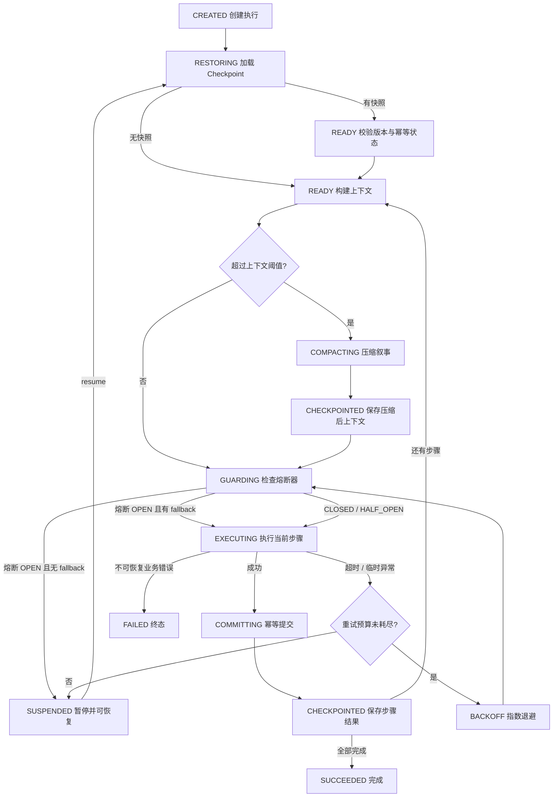

# Agent Harness

后端内嵌的 Agent 工作流运行时。源码位于
`backend/src/main/java/com/travelguide/harness`，由
`backend/pom.xml` 与 Spring Boot 应用统一编译、测试和打包。

## 能力

| 能力 | 实现 |
| --- | --- |
| Checkpoint | `RunCheckpoint` + 内存/JDBC 存储，每次在步骤安全边界推进 |
| 中断恢复 | 协作式中断，已提交步骤不重跑，`resume` 从 `nextStepIndex` 继续 |
| 幂等 | 每个步骤使用稳定幂等键和租约 Claim，完成结果可重放 |
| 上下文压缩 | 仅淘汰旧 `NARRATIVE`，保留 Plan IR、证据、预算/时间、策略和工具结果 |
| 超时 | Resilience4j `TimeLimiter`，每个尝试独立超时并可取消运行中的 Future |
| 重试 | Resilience4j `Retry` + 指数退避，只重试显式声明的临时错误或超时 |
| 熔断 | Resilience4j `CircuitBreaker`，每个 Workflow/Step 独立熔断作用域 |
| 降级 | 熔断打开时可执行步骤级 fallback；无 fallback 时进入可恢复暂停 |

## 状态编排



## 使用

```java
HarnessPolicy policy = HarnessPolicy.defaults();

WorkflowStep retrieve = new WorkflowStep(
        "retrieve-weather",
        context -> {
            // context.idempotencyKey() 必须传给支持去重的下游。
            // 临时网络错误抛 RetryableStepException。
            return StepResult.of("provider-fact-snapshot");
        }
);

WorkflowDefinition workflow = new WorkflowDefinition(
        "travel-plan",
        "v1",
        List.of(retrieve)
);

try (AgentHarness harness = new AgentHarness(
        new JdbcCheckpointStore(dataSource),
        new JdbcIdempotencyStore(dataSource),
        policy
)) {
    HarnessResult result = harness.execute(new HarnessRunRequest(
            "run-20261101-001",
            workflow,
            initialContext
    ));

    if (result.state() == RunState.SUSPENDED) {
        result = harness.resume(workflow, result.runId());
    }
}
```

当前规划链路已接入两个实际步骤：

1. `normalize-requirements`：创建或更新需求草稿。
2. `solve-and-validate`：执行确定性排程与约束校验。

规划接口执行后如返回暂停状态，可携带原请求调用：

```text
POST /api/orchestration/runs/{runId}/resume
GET  /api/orchestration/runs/{runId}
```

恢复前会校验服务端会话用户与检查点所有者一致。

写操作使用 `ExecutionPolicy.once()`，除非下游明确保证按
`StepContext.idempotencyKey()` 去重。可重试读操作使用
`ExecutionPolicy.retryable()`。

## 一致性边界

1. 每个步骤先写幂等 Claim，再执行动作，再提交幂等结果，最后推进 Checkpoint。
2. 如果动作成功但 Checkpoint 写入失败，恢复时会读到幂等完成结果，跳过重复副作用。
3. 如果动作和幂等结果之间进程退出，恢复会以同一幂等键重放。该窗口内的
   exactly-once 依赖下游按幂等键去重，Harness 提供的是可安全重放的协议。
4. `SlidingWindow` 熔断器在当前进程内按 `workflowId:version:stepId` 隔离；
   进程重启后从 `CLOSED` 重建。
5. `requestInterrupt` 是协作式中断。正在执行的步骤不会强杀，而是在超时后或步骤成功后，
   于下一个检查点安全暂停。
6. Harness 步骤在独立线程中执行，可信用户身份通过 `ToolExecutionContext` 显式传播，
   模型和外部 MCP 参数都不能指定用户身份。

## 观测

- 每个 HTTP 请求生成或透传 `X-Trace-Id`，并写入 MDC。
- Harness 状态事件计数通过 Micrometer 暴露为 `agent.harness.events`。
- Actuator 暴露 `health`、`info` 和 `metrics`。

## PostgreSQL

Flyway 迁移文件位于：

```text
backend/src/main/resources/db/migration/postgres/V8__agent_harness.sql
```

Checkpoint 与幂等结果是持久化事实；Redis 等短期缓存不应替代它们。

## 构建与测试

```powershell
cd backend
mvn -Dtest='AgentHarness*Test,ContextWindowCompactorTest' test
mvn package
```

测试覆盖：

- 中断后恢复，已提交步骤不重复执行。
- 幂等结果写入后、Checkpoint 写入前故障的恢复。
- 指数退避重试、步骤超时。
- 熔断打开后的降级路径。
- 上下文压缩的保留/淘汰边界。
- PostgreSQL 兼容 SQL 的 H2 往返测试。

